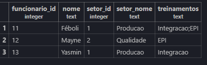
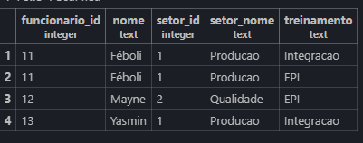
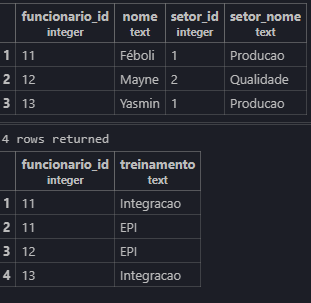
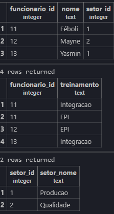

# Atividade prática 12 - Normalização de Banco de Dados

### 1FN:
1- Primeiro criamos o Banco de dados:
```sql
CREATE DATABASE empresa_atividade
```

2- Criamos a tabela cadastro_original:
```sql
CREATE TABLE cadastro_original (
    funcionario_id INTEGER PRIMARY KEY,
    nome TEXT,
    setor_id INTEGER,
    setor_nome TEXT,
    treinamentos TEXT
);
```

3- Inserimos os dados na tabela
```sql
INSERT INTO cadastro_original VALUES
(11, 'Féboli', 1, 'Producao', 'Integracao;EPI'),
(12, 'Mayne', 2, 'Qualidade', 'EPI'),
(13, 'Yasmin', 1, 'Producao', 'Integracao');
```

4- Ao realizar a primeira consulta, verificamos que Féboli está com dois registros na mesma linha!


```sql
SELECT * FROM cadastro_original
```

5- Criamos a nova tabela cadastro_1fn:
```sql
CREATE TABLE cadastro_1fn AS 
SELECT funcionario_id,nome,setor_id,setor_nome,
    string_to_table(treinamentos, ';') AS treinamento
FROM cadastro_original;
```

6- Atribuimos o funcionario_id ao 1FN:
```sql
ALTER TABLE cadastro_1fn
ADD PRIMARY KEY (funcionario_id, treinamento);  
```

7- Assim ficou o resultado da tabela:



---

### 2FN:
1- Primeiro criamos a tabela funcionarios:
```sql
CREATE TABLE funcionarios AS
SELECT DISTINCT funcionario_id,nome,setor_id,setor_nome 
FROM cadastro_1fn;
```

2- Agora nós temos que trazer as chaves primárias com o comando:
```sql
ALTER TABLE funcionarios
ADD PRIMARY KEY (funcionario_id);
```

3- Criamos a tabela participacoes, trazendo apenas o ID do funcionário e os seus treinamentos.
```sql
CREATE TABLE participacoes AS
SELECT funcionario_id,treinamento FROM cadastro_1fn;
```

4- Adicionando as chaves primárias:
```sql
ALTER TABLE participacoes
ADD PRIMARY KEY (funcionario_id,treinamento);
```

5- Adicionando a chave estrangeira (relações entre tabelas):
```sql
ALTER TABLE participacoes 
ADD FOREIGN KEY (funcionario_id) REFERENCES funcionarios(funcionario_id);
```

6- Verificando a 2FN:
```sql
SELECT * FROM funcionarios;
SELECT * FROM participacoes;
```

Resultado:



---

### 3FN:
1- Criamos a tabela setores:
```sql
CREATE TABLE setores AS SELECT DISTINCT setor_id,setor_nome
FROM funcionarios;
```

2- Adicionando a chave primária:
```sql
ALTER TABLE setores 
ADD PRIMARY KEY (setor_id);
```

3- Criando a chave estrangeira:
```sql
ALTER TABLE funcionarios
ADD FOREIGN KEY (setor_id) REFERENCES setores(setor_id);
```

4- Correção do erro na hora de criar a tabela:
```sql
ALTER TABLE funcionarios
ALTER COLUMN setor_id SET NOT NULL;
```

5- Apagamos a coluna setor_nome, uma vez que tiramos essa informação da tabela funcionários 3FN:
```sql
ALTER TABLE funcionarios
DROP COLUMN setor_nome;
```

6- Consultando as tabelas:
```sql
SELECT * FROM funcionarios;
SELECT * FROM participacoes;
SELECT * FROM setores;
```


